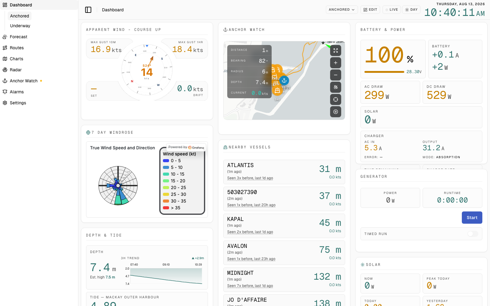

# Helmcentral

> [!WARNING]
> Helmcentral is under active development. Expect breaking changes between
> releases, including to configuration, stored settings and the HTTP API. Read
> the release notes before you upgrade.
>
> That said, it's useful now, and I'd love to hear from anyone who already runs
> SignalK and is willing to try it. Feedback on installing it on other
> platforms would help most.

Helmcentral is a dashboard, alarm system and boat logbook for
[SignalK](https://signalk.org/). It puts anchor watch, tides, weather, tanks,
engines and electrical monitoring on one screen at the helm, drives wall
displays on its own, and sends alarms to your phone when you're off the boat.
It also keeps the paperwork side of the boat: equipment, spares, maintenance,
manuals and notes.

It runs on the boat as a single program with the web app built in. There's no
database server to run and no cloud account to sign up for. If you already have
a SignalK server, one command installs it.



## Why I built it

I spent my working life building software, and I now live aboard full time.
That changes what you want from software on a boat.

Power comes and goes, the internet is patchy, and the person responsible for
the boat is often asleep. So the alarms have to keep running with every
browser closed, an old reading has to look old, and a notification that fails
to send has to be tried again rather than dropped.

That's why anchor watch and alarms run on the server, not in the browser.
Every alarm rule has a dwell time and a clear point, so a reading hovering on
the line doesn't chatter. A watchdog raises its own alarm when the instruments
go quiet, and a heartbeat sent off the boat lets an outside monitor notice when
the whole server goes down. Failed notifications are queued and retried for up
to a day.

## Install

```sh
curl -fsSL https://raw.githubusercontent.com/gterrill/helmcentral/main/install.sh | sh
```

Then open `http://<this-machine>:8080/`. On first run Helmcentral looks for a
SignalK server on your network and offers what it finds, so there's nothing to
edit by hand. Next, tell it which engines, batteries and tanks are yours in
[Set up your vessel](docs/how-to/set-up-your-vessel.md). Nothing is pre-filled
for your boat, so the engine, battery and tank tiles stay empty until you do.

Docker, manual binaries and upgrading:
[docs/how-to/install.md](docs/how-to/install.md).

Not sure it suits your boat? The [FAQ](docs/reference/faq.md) covers what it
needs, what it costs, where it works and what works without an internet
connection. If you're stuck, ask in
[Discussions](https://github.com/gterrill/helmcentral/discussions).

> [!WARNING]
> **Login is off by default** (`auth.mode: none`). On a fresh install, anyone
> on the network can use the API, and it can control connected equipment,
> including generator start and stop and CZone switching. Run it on a trusted
> boat network and don't port-forward it to the internet. Setting
> `auth.mode: signalk` makes everyone log in with their SignalK account; see
> [Authentication](#authentication). For access from ashore, put it behind a VPN
> or an authenticating reverse proxy either way.

## Contents

- [Requirements](#requirements)
- [What's optional](#whats-optional)
- [What it does](#what-it-does)
- [Configuration](#configuration)
- [Provider plugins](#provider-plugins)
- [Documentation](#documentation)
- [Development](#development)
- [Architecture](#architecture)
- [Roadmap](#roadmap)
- [Contributing](#contributing)

## Requirements

- **Linux, macOS or Windows.** Builds cover Linux on x86-64, arm64 and armv7
  (which covers the Raspberry Pi 2, 3, 4 and 5 and the Zero 2 W, but not the
  older ARMv6 boards: the Pi 1, Pi Zero, Zero W and Compute Module 1), plus
  macOS and Windows. Linux gets a
  systemd service. There's nothing else to install alongside it.
- **A SignalK server** on your network, with
  [`signalk-derived-data`](https://github.com/SignalK/signalk-derived-data) for
  true wind and other derived navigation data. If you have a Victron GX, add
  [`signalk-venus-plugin`](https://github.com/sbender9/signalk-venus-plugin) for
  generator and detailed electrical state.
- **A browser that meets Baseline 2024**: Chrome or Edge 111+, Firefox 111+, Safari
  16.4+ (so iPadOS or iOS 16.4+ on a helm tablet). Older devices aren't
  supported. Check a wall panel with `/display-probe.html` before you mount it;
  see [Set up a wall display](docs/how-to/set-up-a-wall-display.md).
- **Nothing to choose for tides.** They come from a worldwide model that follows
  the boat, with heights from mean sea level rather than chart datum. Where a
  station network covers you (Australia or the US), pick that provider in
  Settings for published predictions on chart datum.

## What's optional

The core of Helmcentral (dashboard, alarms, anchor watch, forecast, passages,
inventory, maintenance, documents) needs only SignalK and an internet
connection for the forecast and tides. Everything below is extra, and the
rest of Helmcentral works without any of it.

| Optional | What it adds | What it needs |
| --- | --- | --- |
| [Mate](docs/features/assistant.md) | The chat assistant, Mate's review of each watch report, alarm reviews, proper OCR, summaries, tags and search by meaning in Documents | Your own [OpenRouter](https://openrouter.ai/) account and key. You pay OpenRouter per question; each reply shows what it cost. Off until you turn it on in Settings → Mate |
| [InfluxDB](https://www.influxdata.com/) with [`signalk-to-influxdb-v2`](https://github.com/tkurki/signalk-to-influxdb-v2) | Longer history for charts, and Mate's passage time and fuel estimates from your own logged speed and fuel burn | An InfluxDB server. Without it, telemetry history is kept in memory and the passage log is kept in Helmcentral's own database |
| [Outside assistants](docs/features/outside-assistants.md) | Claude or ChatGPT can read the boat's status, alarms and logs. Read only, and it doesn't use Mate or your OpenRouter key | A token you make in Settings. Claude on a phone and ChatGPT also need a public address, such as Tailscale Funnel |
| [Offline coastline](docs/features/offline-coastline.md) | Charted coastline and reefs stored aboard, so Mate can judge anchorage shelter and passage distance round the land with no signal | Turning it on, and an internet connection while it downloads |
| [Your own Overpass server](docs/how-to/run-your-own-overpass-server.md) | Faster place names and Nearby maps that keep working offline | A second service on the boat's server. Without it, Helmcentral uses a public Overpass server |
| Notification channels | Alarms on your phone or in your email | ntfy, SMTP, a webhook, web push or SignalK itself. Set up the ones you want; none is a paid service |
| [Login](#authentication) | Everyone logs in with their SignalK account | SignalK security turned on first |
| WeatherKit | Apple's forecast in place of Open-Meteo | Apple developer keys |

## What it does

**[The dashboard](docs/features/dashboard.md).** You build pages of tiles for
each job: anchored, under way, an engine watch. Twenty tiles come built in,
from Vessel and Wind through Current, Battery & Power, Autopilot and Forecast
Conditions. You can add gauges for any reading the boat publishes, an
[Engine Cluster](docs/features/engine-cluster.md) tile per engine, and embed
tiles for anything with a URL, such as a camera feed. Pages are saved on the
server, so every screen on the boat sees the same ones. A gauge's coloured
bands can become an alarm in one step.

**[Wall displays](docs/features/dashboard.md#wall-displays).** Name a screen,
give it a size and an orientation, and assign pages to it. Then
`/display/<name>` cycles through them full screen with no menus, on its own.
A page can show only while a condition holds, such as at anchor. A display
always renders dark, shows a small status pill rather than full banners, and
can shift its pixels slowly to spare an OLED panel. A strip at the helm and a
television in the saloon can each run their own pages.

**[Anchor watch](docs/features/anchor-watch.md).** Drag detection runs on the
server for your own boat and for nearby AIS targets, with every screen
switched off. A lost GPS fix never raises a drag alarm; it raises its own
alarm instead, because the two need different responses. The rode planner
works out how much to pay out against tide-corrected depth, and shows each
method's rode in a side view. The anchor map shows other boats' trails while
the watch is set.

**[Alarms](docs/features/alarms.md).** Rules on any live reading, including
from gear you add later, with no software update needed. Alarms raised by a
Victron GX, an engine gateway or another SignalK plugin show up in the same
list, and Helmcentral's own alarms can go back onto SignalK so a chartplotter
can react too. A fresh install comes with heavy-weather rules already on: a
barometer ladder on the three-, twelve- and twenty-four-hour tendency, and
rules tied to the official marine warnings for your zone. Tank levels have
their own alarms, and phone and email notifications can carry a chart of the
reading.

**[Anomaly detection](docs/features/anomaly-detection.md).** Checks for
trouble a plain threshold misses: a sensor that has frozen or is reporting
something impossible, alternators still pushing a full house bank, and one
engine of a pair pulling away from its twin at the same rpm.

**[Forecast](docs/features/forecast.md).** Ten days of weather, wind, waves and
tide for wherever the boat is, read from its own GPS. Today, the ten-day
picture and the upper-air pattern each get their own panel. The defaults
(Open-Meteo and Open-Meteo Marine) need no API key.

**[Watches](docs/features/watches.md).** Regular checks of the boat at times
you choose. Each one builds a short report in the same shape every time, with
a list of findings from rules you can read. The morning report at 6.00 AM
tells you what happened overnight. With Mate on, it adds a few sentences on
what the report means.

**[Passages](docs/features/passages.md).** The boat's logbook, recorded
whether or not anyone has a screen open. Every leg with its distance and time,
what the engines, battery and wind did, and what the nights at anchor cost in
power and water. You can replay any passage or a whole cruise on the chart,
[export the replay as a video](docs/how-to/film-a-passage-replay.md), or
[put it on your blog](docs/how-to/share-a-passage-on-your-blog.md). GPX tracks
from other apps can be imported.

**[Place names and nearby places](docs/features/place-names.md).** The bay,
marina or island you're in shows on the position tile and the anchor pin. A
Nearby map tile shows anchorages, marinas, fuel, ramps, moorings, dive spots,
walking trails and more around the boat, along with the vessels nearby. The
default source is OpenStreetMap and needs no key.

**[Inventory](docs/features/inventory-tracking.md).** One record per piece of
gear, from a bilge pump to a main engine, with where it's stowed, its spares,
manuals and photos. Bins can carry QR or NFC labels a phone can scan, deck
plans show where each bin is, and a stocktake walks the boat locker by locker.

**[Maintenance](docs/features/maintenance.md).** Jobs that fall due on running
hours read live from the engines, on the calendar, or both. Gear with no hour
meter can use hours you read by hand. One list shows what's due, what's
overdue and what's done, with the service log kept against the equipment, and
open jobs for the problems you know about and haven't fixed yet.

**[Documents](docs/features/documents.md) and
[notes](docs/features/notes-and-the-manual.md).** Manuals, receipts, service
logs and photos of data plates, kept on the boat and searchable there. Text is
extracted when you upload. A note takes one step to capture, and a folder of
notes becomes the boat's own manual.

**[Import](docs/features/import.md).** Equipment, spares, the service log,
notes and documents come across from YachtWave rather than being retyped.

**[Mate](docs/features/assistant.md)** (optional, see above). A chat assistant
that answers from the boat's live data. Ask "should we take Tongue Bay or Blue
Pearl Bay over the next two days" and it looks both up, checks the wind, waves
and tide for each, and answers in your units and time zone. It works out wind
angle against your course with arithmetic rather than leaving it to the model.
It can assess an anchorage or a marina for your stay, measure a leg round the
islands, summarise your passages, review an alarm when it goes off, and
remember facts about your boat. It can also propose changes to alarms, the
maintenance schedule, the inventory and the boat's details, but nothing
changes until you tap **Apply**. It can't start, stop, switch or steer
anything. You can type or talk to it (push-to-talk is `Alt+M`).

**The help is built in.** The `?` button in the header opens the help page for
the screen you're on, with no internet needed. Mate reads the same pages when
you ask how something works.

**Every screen has its own address**, such as `/forecast`, `/anchor-watch` or
`/dashboard/<page id>`. You can send someone a link and it opens where you
meant, Back and Forward work, and tapping an alarm notification opens the
Alarms panel.

Also included: a Route tile that follows the route SignalK is navigating,
autopilot control through SignalK's v2 API, and an embedded Windy weather
map.

Helmcentral doesn't do hazard avoidance, weather routing, live navigation, or
anything that needs a chart licence. Keep using your chartplotter for those.

## Configuration

Helmcentral starts with no configuration file. **Secrets never go in files or
environment variables.** You paste SignalK credentials, the InfluxDB token,
WeatherKit keys and your OpenRouter key into the matching Settings section in
the running app, and they're encrypted at rest with AES-256-GCM.

> Back up the whole `data/` directory and `settings.yaml`. If you lose
> `data/secrets.key`, every stored credential is unrecoverable. How to copy the
> database safely while it's running is in
> [Back this up](docs/reference/configuration.md#back-this-up).

### Authentication

`auth.mode` defaults to `none`, so upgrading never locks anyone out of a
running boat. With `auth.mode: signalk`, the API and dashboard answer nothing
but `/api/health` and the login screen until you log in.

Helmcentral has no user list of its own. It passes the login to your SignalK
server and maps SignalK's `readonly`, `readwrite` and `admin` levels onto
matching permissions. A role it doesn't recognise gets no access, rather than
falling back to something more permissive.

Turn on SignalK's security first, then turn on login in Settings → Security.
Helmcentral won't save the setting until SignalK security is on. With login
on, Helmcentral won't start if it can't reach SignalK, which matters after a
power cut, or if SignalK's security has been turned off since. How to get it
going again is in the [FAQ](docs/reference/faq.md#what-about-security).
Turning login off doesn't need SignalK to be reachable, so that way out always
works.

Every environment variable, state path and startup behaviour:
[docs/reference/configuration.md](docs/reference/configuration.md).

## Provider plugins

Tides, weather, waves, forecast warnings and points of interest come from
plugins loaded from disk. To add a provider, put its `.wasm` file in its
plugin folder and restart Helmcentral; it then shows up in Settings. There's
no need to rebuild Helmcentral.

| Category | Bundled plugins |
| --- | --- |
| Tides | `open-meteo` (worldwide, no key, follows the boat, default), `bom` (Australia), `noaa` (US) |
| Weather | `open-meteo` (worldwide, no key, default), `weatherkit` (Apple, needs keys) |
| Waves | `open-meteo-marine` (default) |
| Forecast warnings | `bom` (Australia, default), `nws` (US) |
| Points of interest | `osm-overpass` (worldwide, no key, default), `google-places` (needs a key, covers some categories) |

Plugins are WebAssembly modules run under [Extism](https://extism.org/) and
[wazero](https://wazero.io/). They get no file access and no process access,
and they can only reach the hosts listed in their `allowed_hosts.json`. A
plugin returns only the provider's raw numbers; Helmcentral does the
distances, bearings and ranking itself. You can write one in any language with
an Extism PDK.

Installing and configuring plugins:
[docs/reference/plugins.md](docs/reference/plugins.md). How to build one:
[docs/developers/plugins.md](docs/developers/plugins.md).

## Documentation

Start with [docs/index.md](docs/index.md). The same pages ship inside the
program, so the help is on the boat whether or not the boat has a connection.

| | |
| --- | --- |
| [docs/features/](docs/features/) | What each part does and where it stops |
| [docs/how-to/](docs/how-to/) | Install, upgrade, wall displays, Mate, outside assistants, and more |
| [docs/reference/faq.md](docs/reference/faq.md) | Frequently asked questions: hardware, internet, cost, regions, forecasts, using it ashore, security |
| [docs/reference/](docs/reference/) | Configuration, plugins, place categories, engine profiles |
| [docs/adr/](docs/adr/) | Why it was built the way it was |

Edit help pages under `docs/` only. `make help-stage` copies them into
`backend/help/` for the build, and a build without that step says the help is
missing rather than serving old pages.

## Development

You need Go (the version in `backend/go.mod`) and Node.js 20 or newer. From the
repository root, in two terminals:

```sh
make help-stage                             # stage docs/ for the built-in help
cd backend && go run .                      # API on :8080
```

```sh
cd frontend && npm install && npm run dev   # Vite dev server on :5173
```

Tests:

```sh
cd backend && go test -short ./...
cd frontend && npm test && npm run lint
```

If you're working in two sessions at once, `make worktree NAME=<short-name>`
gives the second its own checkout next to this one, with
`frontend/node_modules` linked so tests run straight away. Only one checkout
can run the dev stack, since the ports are fixed.

Docker workflows, the isolated end-to-end stack and release builds:
[docs/developers/development.md](docs/developers/development.md).

## Architecture

```
helmcentral/
├── backend/          # Go API; embeds the built frontend and the help
├── frontend/         # React + TypeScript + Vite dashboard
├── plugins/          # WASM providers, by category
├── packaging/        # systemd unit, plugin build script
├── docs/             # Operator docs and architecture decision records
├── install.sh        # One-line installer
└── docker-compose.yml
```

- **Backend.** Go and Echo, serving the API and the web app from one port. Any
  path that isn't a file gets the app, which is what makes links to a screen
  work on a fresh load. Endpoint reference: [backend/README.md](backend/README.md).
- **Frontend.** React and TypeScript, built with Vite, made for a touchscreen
  at the helm.
- **Data in.** One WebSocket subscription to SignalK's delta stream, built up
  into a snapshot. There's no REST fallback, because a fallback would hide the
  very outages the watchdog is there to catch. REST is used only to probe
  servers during discovery and connection tests.
- **Storage.** SQLite for secrets, alarm rules and history, documents and
  notes, inventory, maintenance and Mate's conversations. Settings live in
  `settings.yaml`, and dashboard pages and the anchor watch in JSON files.
  Recent telemetry is held in memory, with InfluxDB optional for more.
- **Startup.** If the secrets store or a plugin-override database can't be
  opened, the program exits rather than running half-working.

### Why it isn't a SignalK plugin

SignalK turns NMEA 2000 into one tree of documented paths in standard units.
Helmcentral uses that rather than decoding NMEA 2000 itself.

SignalK plugins run inside SignalK's own Node process. Any plugin there can
add HTTP routes, inject fake readings, read the server's configuration or
crash the whole server. Helmcentral runs as its own process so that alarms
keep working when another plugin misbehaves.

NMEA 2000 has no device authentication: any device on the bus can claim an
address and send anything. Software can't make that data trustworthy, but it
can control who sends commands. Engaging an autopilot or switching a CZone
breaker needs access control, and the boat's network needs a boundary
between it and the internet.

So Helmcentral treats SignalK as a translator and keeps those boundaries
itself. It reads SignalK through one subscription into its own snapshot,
works out roles after SignalK and refuses an unknown one, and runs
third-party provider code in WebAssembly with its own memory, a host
allowlist and a hard time limit.

## Roadmap

- **Guided first-run setup** that walks through engines, battery banks and
  tanks using what the boat already reports.
- **Automatic backups** to a drive or network share you choose, including the
  key that unlocks stored credentials.
- **RFID stocktakes**, walking the boat with a reader instead of opening
  lockers. Designed but not built yet:
  [docs/features/inventory-tracking.md](docs/features/inventory-tracking.md#rfid-tags).
- **Login on by default.** It's built and you can turn it on, but it stays off
  by default for now so that an upgrade can't lock anyone out. A later major
  version will turn it on once people have had a release to opt in.
- **Finding SignalK by mDNS** for native installs.

## Contributing

Questions, install help, ideas and photos of Helmcentral on your boat go in
[Discussions](https://github.com/gterrill/helmcentral/discussions). Issues are
for bugs and changes ready to work on.

Pull requests are welcome. CI runs `go vet`, the Go and frontend tests, lint
and a full cross-platform release build on every PR, so run those locally
first (see [Development](#development)).

If a change rests on a trade-off that isn't obvious, add an ADR for it in
[docs/adr/](docs/adr/). If it changes what someone sees on the boat, update
the matching page under [docs/](docs/) too.

## License

[MIT](LICENSE)
